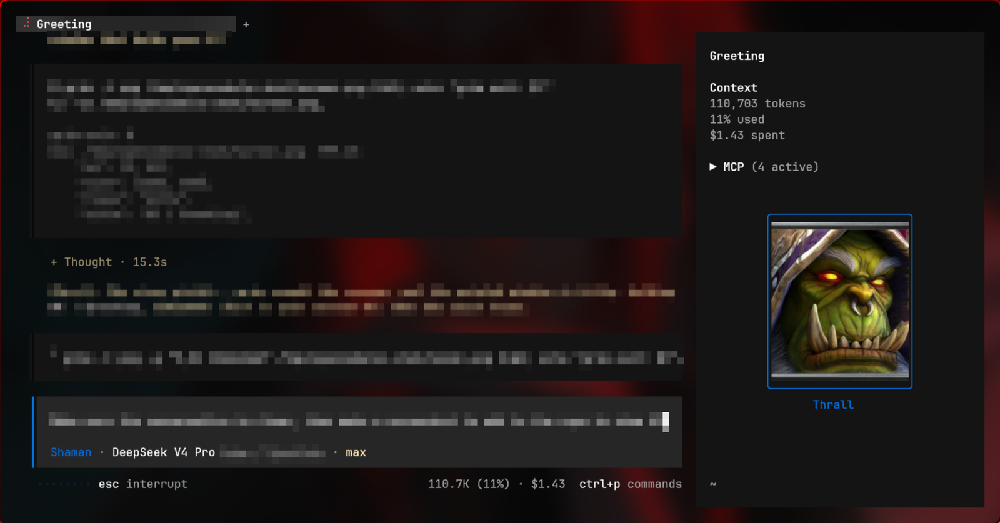

# opencode-agent-avatars

Still-image avatars for [OpenCode](https://opencode.ai) agents in the TUI. The plugin shows the active agent's portrait in the sidebar. Each agent gets its own image.

## What it looks like



*The author's OpenCode TUI (Hyprland, kitty). Private details in the capture are blurred. The portrait shown is a Warcraft III: Reforged icon (© Blizzard Entertainment) from the author's personal setup — it is not part of the plugin.*

## Install

Run this in a terminal (verified with OpenCode v2.2.3):

```sh
opencode plugin add github:adam-benyekkou/opencode-agent-avatars
```

The command adds this line to your `opencode.json`:

```jsonc
"plugins": ["github:adam-benyekkou/opencode-agent-avatars"]
```

Keep that line as a plain string. Do not put settings there. Settings go in `cli.json`, as described in [Aliases](#aliases) and [Options](#options).

**If the install command fails,** some systems hit a known OpenCode issue (#49785) with git-based installs ("git dep preparation failed"). Clone the repository into OpenCode's global plugin folder instead. OpenCode loads plugins from that folder at startup, so restart OpenCode after cloning:

```sh
git clone https://github.com/adam-benyekkou/opencode-agent-avatars ~/.config/opencode/plugins/opencode-agent-avatars
```

## Add your images

Put one image per agent in the avatar folder. Name each file after the agent id, for example `Warrior.png`.

```
~/.config/opencode/avatars/
├── Warrior.png
├── shaman.jpg
└── Hunter.webp
```

Supported formats: `png`, `jpg`, `jpeg`, `webp`, `gif` (first frame only).

The default folder depends on your platform:

| Platform | Default folder |
| --- | --- |
| Linux, macOS | `~/.config/opencode/avatars` |
| WSL | `~/.config/opencode/avatars` (same as Linux) |
| Windows (native) | `%APPDATA%\opencode\avatars` |

If `%APPDATA%` is not set on native Windows, the folder is `~/AppData/Roaming/opencode/avatars`. To use another folder, set the `directory` option.

The plugin looks for an agent's image in this order:

1. The explicit `avatars` option for that agent.
2. The exact agent id, such as `Warrior.png`.
3. The lowercase id, such as `warrior.png`.
4. The kebab-case id, such as `cairne-bloodhoof.png` for the agent `CairneBloodhoof`.

If no image is found, the plugin draws a colored box with the agent's initials. Nothing breaks.

## Aliases

An alias changes the name shown under the portrait. It does not rename the agent.

**Where aliases go:** in the `aliases` key, inside the plugin's `options`, in `~/.config/opencode/cli.json`. They do not go in `opencode.json` or `opencode.jsonc`.

If `cli.json` does not exist yet, create it with this content:

```jsonc
{
  "$schema": "https://opencode.ai/v2/cli.json",
  "plugins": [
    {
      "package": "github:adam-benyekkou/opencode-agent-avatars",
      "options": {
        "directory": "~/.config/opencode/avatars",
        "aliases": { "Warrior": "Cairne", "Shaman": "Thrall" }
      }
    }
  ]
}
```

In this example:

- The left side (`"Warrior"`) is the agent id from your agents config. It is not case-sensitive.
- The right side (`"Cairne"`) is the name shown under the portrait.
- Agents with no alias keep their configured name.

## Options

Options go in `cli.json`, inside the plugin's `options` object, as shown in [Aliases](#aliases).

| Option | Default | What it does |
| --- | --- | --- |
| `directory` | Per OS (see [Add your images](#add-your-images)) | Folder to read images from. |
| `aliases` | `{}` | Name shown under the portrait, keyed by agent id. |
| `avatars` | `{}` | Exact image file for an agent, such as `{ "Warrior": "/path/to/cairne.png" }`. |
| `mode` | `"active"` | `"active"` shows the current agent. `"all"` shows every agent that is not a subagent. |
| `width` | `20` | Image width in terminal cells. |
| `height` | `10` | Image height in terminal cells. |
| `fit` | `"cover"` | How the image scales: `"fit"`, `"cover"`, or `"fill"`. |
| `protocol` | `"auto"` | Image method: `"auto"`, `"kitty"`, `"sixel"`, or `"blocks"`. |
| `slot` | `"sidebar.content"` | Where the avatar appears: `"sidebar.content"`, `"sidebar.footer"`, or `"session.composer.top"`. |
| `label` | `true` | Show the agent name under the image. |

## Terminal support

With `"protocol": "auto"` (the default), the plugin picks the best option for your terminal:

| Terminal | Protocol used |
| --- | --- |
| Ghostty, Kitty, WezTerm | Kitty graphics |
| Konsole, foot, xterm, Windows Terminal | SIXEL |
| Other terminals | Unicode blocks (works everywhere, lower detail) |

To force one protocol, set `protocol` in the options. The environment variable `OPENTUI_IMAGE_PROTOCOL` can also set the protocol.

## Artwork and licensing

- The plugin ships no art. You supply your own images.
- The demo imagery in `assets/` is the author's setup, shown as an illustration. The game icon in it is © Blizzard Entertainment.
- Do not commit third-party copyrighted art to a public repository unless you have the right to redistribute it.

## License

MIT. See [LICENSE](LICENSE).
